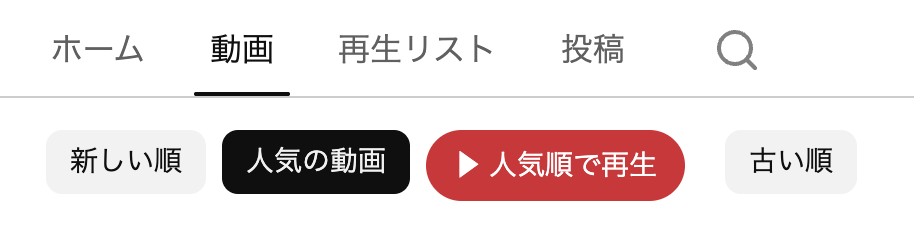

<div align="center">
  <h1>YouTube Popular Player</h1>
  <p>YouTubeのチャンネル人気順をそのまま再生</p>
  
</div>

## インストール

1. [ソースコードのZIP](https://github.com/fjt-dev/youtube-popular-player/archive/refs/heads/main.zip)をダウンロードし、展開します。
2. Chromeは `chrome://extensions`、Edgeは `edge://extensions` を開きます。
3. **デベロッパーモード**（Edgeは **開発者モード**）をオンにします。
4. **パッケージ化されていない拡張機能を読み込む** を押し、`manifest.json` が入っているフォルダを選びます。
5. 開いているYouTubeのページを再読み込みします。

読み込んだフォルダは、拡張機能を利用している間は残してください。

## 使い方

チャンネルの **動画 → 人気の動画 → ▶ 人気順で再生** の順に選びます。並べ替えがドロップダウンになっている画面でも使えます。

一覧を自動スクロールしながら、再生する動画を集めます。読み込みが終わると、最初の動画名とプレイリストを短く表示し、自動で再生が始まります。追加の再生開始操作は必要ありません。

途中までの一覧で始める場合は **ここまでで再生**、準備を中止する場合は **キャンセル** を押します。

## 再生バナーの使い方

再生中は、画面右下に「現在の位置／対象本数」と次の動画名を表示します。アイコンにカーソルを合わせると操作名が分かります。

| 操作       | 動作                                                        |
| ---------- | ----------------------------------------------------------- |
| 前へ       | 一覧の前の動画へ移動します。                                |
| ■          | 終了の確認を開きます。**終了する** で連続再生を終了します。 |
| 次へ       | 一覧の次の動画へ移動します。                                |
| 再生リスト | バナーの上にプレイリストを開閉します。                      |

### プレイリストから動画を選ぶ

一覧には順位と動画名が並び、再生中・次に再生する動画にはラベルが付きます。動画名を押すと、その動画へ移動し、以降は保存された順番で再生します。

一覧を開くと、再生リストボタンが色付きの上向きアイコンに変わります。同じボタンか、一覧内で **Escape** キーを押すと閉じます。

### 連続再生を終了する

**■ → 終了する** の順に押します。確認を取り消す場合は **続ける**、または **Escape** キーを押してください。

終了するのは拡張機能による連続再生です。再生中の動画自体は止まりません。別の動画やチャンネルを手動で開いた場合も、連続再生を終了します。

## よくある質問

### 再生ボタンが表示されない

チャンネルの **動画** タブで **人気の動画** を選んでいるか確認してください。拡張機能を読み込んだ直後は、YouTubeのページを再読み込みします。

### 読み込み後に動画が再生されない

ブラウザが自動再生を制限している場合があります。YouTubeの動画プレーヤーにある再生ボタンを押してください。

### 人気順と関係ない動画に切り替わる

YouTube側の自動再生をオフにして、チャンネルからもう一度開始してください。

### 再生できない動画で止まる

再生バナーの **次へ** で進めます。非公開・削除済み・年齢制限などの動画は、自動スキップしません。

### チャンネルの全動画が入らない

読み込みは最大 **1,000本・90秒** です。6.5秒間動画が増えない場合も取得を終えるため、通信状況などによって上位の一部だけになることがあります。対象本数は再生バナーで確認できます。

### ショートやライブも再生できる？

対象は「動画」タブの通常動画です。ショート・ライブの専用タブは対象外です。

## 更新とアンインストール

更新するときはファイルを差し替え、拡張機能の管理画面で **再読み込み** を押します。YouTubeのページも再読み込みし、チャンネルから再生を開始してください。

使わなくなった場合は、拡張機能の管理画面から **削除** を選びます。

## データの扱い

動画ID・動画名・開始元URL・再生位置を、`storage` 権限でブラウザ内の一時領域に保存します。再生リストはタブごとに管理し、ブラウザの終了・拡張機能の再読み込み・開始から24時間経過で失効します。

拡張機能がこれらのデータを外部サーバーへ送信する処理はありません。YouTubeアカウントの再生リストも作成・変更しません。視聴履歴やYouTubeとの通信は、通常の動画再生と同様に発生します。

## 開発とテスト

拡張機能を使うだけならNode.jsは不要です。開発時はNode.js 22以降で、リポジトリ内から次を実行します。

```sh
npm ci
npm test
```

Push時とPull Requestの作成・更新時には、GitHub ActionsがNode.js 22／24でテストを実行します。[Actions](https://github.com/fjt-dev/youtube-popular-player/actions)で結果の確認と手動実行ができます。
